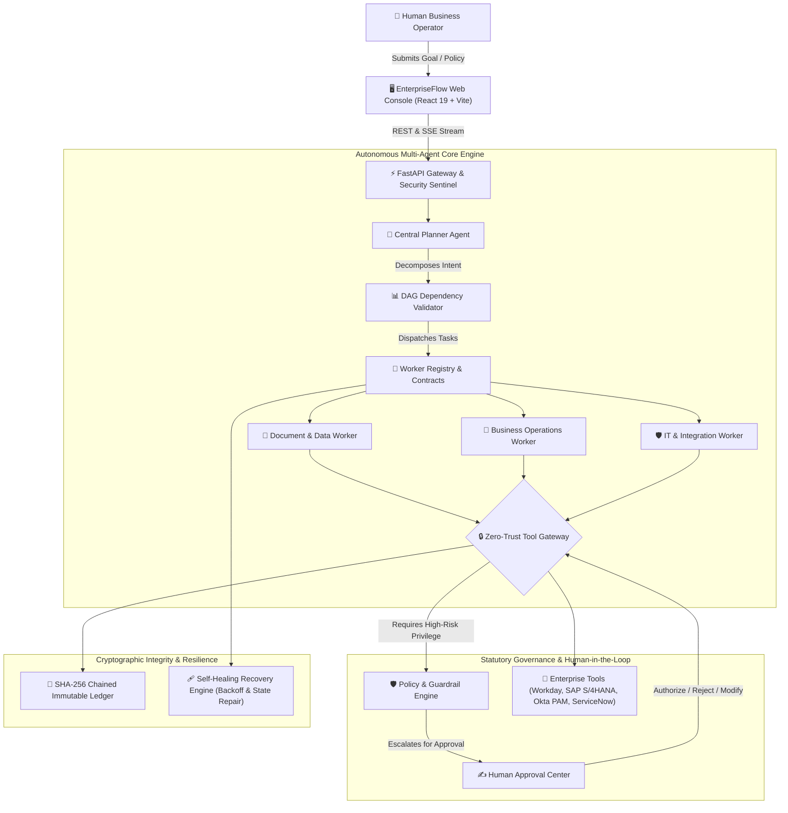

<div align="center">

# ⚡ EnterpriseFlow AI • Autonomous Multi-Agent Operations Platform

**Next-Generation Hierarchical Multi-Agent Orchestration with Dynamic DAG Planning, Statutory Governance & Human-in-the-Loop Authority**

[](https://www.python.org/)
[](https://fastapi.tiangolo.com/)
[](https://react.dev/)
[](https://www.typescriptlang.org/)
[](https://vitejs.dev/)
[](https://tailwindcss.com/)
[](https://opensource.org/licenses/Apache-2.0)
[](https://inr.org)
[](https://time.is/IST)

<p align="center">
  <em>"AI agents execute the operations. Humans retain ultimate authority. Every decision is cryptographically accountable."</em>
</p>

[Key Features](#-key-features) •
[Architecture](#-system-architecture) •
[Five Enterprise Domains](#-five-enterprise-domains) •
[Quick Start](#-quick-start-guide) •
[Verification](#-testing--verification) •
[API Reference](#-api-endpoints)

---

</div>

## 🌐 Executive Overview

**EnterpriseFlow AI** is an enterprise-grade multi-agent autonomous operations ecosystem designed for high-stakes corporate environments. Unlike naive single-prompt systems, EnterpriseFlow decouples business goal decomposition from execution through a 4-tier hierarchical topology:

1. **Level 1 — Natural Language Intent Understanding**: Parses complex business goals and extracts strict constraints.
2. **Level 2 — Central Dynamic DAG Planner**: Generates non-cyclic directed acyclic graphs (DAGs), sequences dependencies, and executes self-healing dynamic re-planning upon task failure.
3. **Level 3 — Specialized Autonomous Domain Agents**: Executes tasks using structured worker contracts, shared cryptographic context, and zero-trust tool invocations.
4. **Level 4 — Backend-Enforced Governance & Human Approvals**: A high-density approval command center enforcing mandatory role-based authority, immutable SHA-256 hash-chaining, and statutory compliance (CERT-In 6-Hour Rule, RBI Harmonisation, Section 194J TDS, and MSMED Act 2006).

---

## 🏛️ System Architecture



---

## 💎 Key Features

- **Central Planner Agent & Self-Healing DAG**: Authoritative planner decomposing enterprise goals into acyclic execution graphs with live rollback and autonomous self-healing.
- **Human-in-the-Loop Gateway**: High-density approval drawer with risk tiering (LOW, MEDIUM, HIGH, CRITICAL), AI proposal diffs, and biometric/FIDO2 MFA authorization.
- **Tamper-Evident SHA-256 Audit Trail**: Every agent tool call, worker handoff, and human decision is cryptographically chained with live tamper detection and verification.
- **Zero-Trust Tool Gateway**: Agents never access internal databases or external APIs directly; every call is inspected, rate-limited, and authorized by policy sentinels.
- **Full Indian Statutory Compliance & INR Currency**: All financial evaluations and workflows are natively configured in Indian Rupees (`₹ INR`) with live India Standard Time (`IST`, UTC+5:30, 12-hour AM/PM format).
- **Chaos Engineering Console**: Real-time chaos injection testing HTTP 409 collisions, 429 rate limit backoff, timeout circuit-breaking, and malformed payload self-healing.

---

## 🏢 Five Enterprise Domains

EnterpriseFlow AI includes five end-to-end, fully connected business modules with dedicated web interfaces and real-time backend engines:

### 1. 👥 Intelligent Employee Onboarding & Real Email Dispatcher (`/onboarding`)
- **Profile Extraction & Verification**: Autonomous OCR parsing of identity documents, Aadhaar/PAN validation, and EPFO Form 11 statutory declarations.
- **Corporate Provisioning**: Creates Workday HCM worker profiles, provisions Google Workspace enterprise mailboxes, and configures Okta SSO profiles.
- **Hardware & Welcome Package Allocation**: Auto-assigns Apple MacBook Pro M3 / Dell XPS laptops with Blue Dart courier tracking IDs and joining bonus disbursements.
- **Real-Life SMTP Email Dispatcher**: Includes live Internet SMTP transmission via Google App Password / SMTP Relay to deliver branded corporate onboarding emails directly to candidate personal inboxes.

### 2. 🧾 Intelligent Invoice Processing & 3-Way Matching Sentinel (`/invoice`)
- **3-Way PO Reconciliation**: Automated matching between Supplier Invoice, Purchase Order (PO), and Goods Receipt Note (GRN) with line-item variance tolerance.
- **Indian Statutory Taxation (TDS & GST)**: Automatic calculation under Section 194J (10% Technical), 194C (2% Contractor), and 194Q (0.1% Goods), with 18% CGST/SGST/IGST breakdown.
- **Invoice Registration Portal**: Live GSTIN verification and 64-character GST e-Invoice IRN (Invoice Reference Number) validation with SAP S/4HANA disbursement integration.

### 3. 💬 Customer Requests Resolution & RBI Harmonisation TAT (`/customer`)
- **RBI Circular Compliance**: Implements RBI DPSS.CO.PD No.629 mandate enforcing T+1 to T+5 turnaround timelines for failed transactions and unauthorized electronic banking events.
- **Statutory Delay Penalty**: Autonomous calculation of mandatory **₹100/day penalty compensation** credited directly to customer accounts upon SLA breaches.
- **Sentiment & Intent Analysis**: Autonomous customer sentiment triage with automated Zendesk ticket resolution and account ledger adjustments.

### 4. 🛒 Enterprise Procurement & Vendor Master (`/procurement`)
- **MSMED Act 2006 Statutory Protections**: Enforces Section 15 & 16 mandates capping vendor payments at a maximum of **45 days** for registered Micro, Small, and Medium Enterprises (MSMEs).
- **Statutory Compounded Interest**: Automated penal interest calculation at **3x RBI Repo Rate (19.5% p.a.)** compounded monthly for overdue MSME disbursements.
- **GeM & Tender Analysis**: 3-quote competitive evaluation, volume discount scoring, and Coupa PO issuance.

### 5. 🛡️ IT Incident Response & CERT-In Access Governance (`/it-incident`)
- **CERT-In 6-Hour Disclosure Mandate**: Real-time tracking of Section 70B(6) Indian Information Technology Act 2000 requiring cybersecurity incidents to be reported within 6 hours.
- **Automated ServiceNow Remediation**: Auto-cycles deadlocked connection pools and restarts faulty containers.
- **Ephemeral JIT PAM Elevation**: One-click provisioning and instant administrative revocation of 2-hour or 4-hour `ClusterAdmin` credentials authenticated via CyberArk / Okta FIDO2 YubiKey MFA.
- **180-Day ICT Audit Vault**: Immutable log retention synchronized to **NIC / National Physical Laboratory (NPL)** atomic NTP standard time.

---

## ⚡ Quick Start Guide

### Prerequisites
- **Python**: 3.10+ (tested on Python 3.12)
- **Node.js**: v18+ (tested on Node v20 & v24)
- **Git**

### 1. Clone the Repository
```bash
git clone https://github.com/aeternum-core/enterpriseflowai_dotx.git
cd enterpriseflowai_dotx
```

### 2. Backend Setup & Startup
```bash
# Set Python path to backend
$env:PYTHONPATH="backend"   # Windows PowerShell
# export PYTHONPATH="backend" # Linux/macOS

# Install backend dependencies
python -m pip install -r backend/requirements.txt  # or install fastapi uvicorn sqlalchemy pydantic ruff pytest pyright

# Start the FastAPI engine with auto-reload
python -m uvicorn app.main:app --host 127.0.0.1 --port 8000 --reload
```
*Backend runs on `http://127.0.0.1:8000`. Interactive OpenAPI documentation available at `http://127.0.0.1:8000/docs`.*

### 3. Frontend Setup & Startup
```bash
cd frontend

# Install frontend dependencies
npm install

# Start Vite development server
npm run dev -- --host 127.0.0.1 --port 5173
```
*Frontend runs on `http://127.0.0.1:5173`.*

---

## 🧪 Testing & Verification

EnterpriseFlow AI includes a comprehensive automated test suite covering multi-agent orchestration, dynamic DAG validation, human approval gates, security boundaries, and statutory compliance:

```bash
# Run the complete test suite
$env:PYTHONPATH="backend"; pytest backend/tests -v
```

### Test Coverage Highlights:
- ✅ **Central Planner DAG**: Verifies goal decomposition into acyclic dependency graphs and rejection of cyclic loops.
- ✅ **Worker Contracts & Context**: Validates shared immutable context propagation between Level 3 workers.
- ✅ **Chaos Resilience Engine**: Tests HTTP 409 conflict retries, 429 rate limit backoff, and idempotent recovery.
- ✅ **Security & Authorization Sentinel**:
  - Blocks autonomous agents from approving their own sensitive actions (`UNAUTHORIZED_SELF_APPROVAL`).
  - Rejects approval attempts by unauthorized roles (`ROLE_MISMATCH`).
  - Blocks unapproved high-risk API invocations at the Tool Gateway (`TOOL_ACCESS_DENIED`).
- ✅ **Cryptographic Tamper Detection**: Proves that modifying any historical block in the SHA-256 chain immediately breaks downstream validation.
- ✅ **Indian Statutory Workflows**: Validates TDS Section 194J/194C calculation, CERT-In 6-hour disclosure filing, and JIT PAM elevation lifecycle.

---

## 📁 Repository Structure

```
enterpriseflowai_dotx/
├── backend/
│   ├── app/
│   │   ├── main.py                     # FastAPI application entrypoint & live SSE events
│   │   ├── core/                       # Database engine, SQLAlchemy Base, app configuration
│   │   ├── models/                     # Relational schemas (Workflows, Approvals, Audit, Recovery)
│   │   ├── schemas/                    # Pydantic v2 strict data contracts & worker schemas
│   │   ├── agents/
│   │   │   └── workers.py              # Level 3 Domain Workers (DocData, BizOps, ITInteg)
│   │   ├── planner/
│   │   │   └── dag_validator.py        # Topological sort & cycle detection engine
│   │   ├── recovery/
│   │   │   └── chaos_engine.py         # Chaos injection & resilience simulators
│   │   ├── services/
│   │   │   ├── workflow_engine.py      # Core execution orchestrator & state machine
│   │   │   ├── approval_engine.py      # Human-in-the-loop authorization engine
│   │   │   ├── tool_gateway.py         # Zero-Trust authorized tool gateway
│   │   │   ├── policy_engine.py        # Pre-execution policy & risk sentinel
│   │   │   ├── audit_service.py        # Cryptographic SHA-256 hash-chain ledger
│   │   │   ├── email_service.py        # Real-world SMTP email dispatcher with TLS/SSL
│   │   │   └── recovery_engine.py      # Exponential backoff & self-healing runner
│   │   └── api/                        # REST routers (Approvals, Workflows, Domains, etc.)
│   └── tests/                          # 21 automated integration & security test suites
├── frontend/
│   ├── src/
│   │   ├── components/
│   │   │   ├── layout/                 # EnterpriseLayout with Live IST 12-Hour Clock
│   │   │   ├── approvals/              # High-density approval table, drawer & modal
│   │   │   ├── canvas/                 # Interactive React Flow DAG execution canvas
│   │   │   ├── chaos/                  # Live chaos testing & failure simulator console
│   │   │   ├── common/                 # LiveIndiaClock, metrics, and badge components
│   │   │   └── onboarding/             # Real-world SMTP credentials modal & guide
│   │   ├── pages/
│   │   │   ├── EmployeeOnboardingPage.tsx   # Employee onboarding & welcome letter dispatch
│   │   │   ├── InvoiceProcessingPage.tsx    # 3-Way matching & Section 194J TDS hub
│   │   │   ├── CustomerRequestsPage.tsx     # RBI TAT harmonisation & refund compensation
│   │   │   ├── ProcurementVendorsPage.tsx   # MSMED Act 2006 45-day payment sentinel
│   │   │   ├── ITIncidentAccessPage.tsx     # CERT-In 6-hour disclosure & JIT PAM hub
│   │   │   ├── PlannerPage.tsx              # Interactive goal decomposition studio
│   │   │   └── WorkflowsPage.tsx            # Live multi-agent pipeline monitoring
│   │   ├── context/                    # AuthContext & LiveWorkflowContext (SSE Stream)
│   │   └── utils/
│   │       └── timeUtils.ts            # Indian Standard Time (IST) 12-hour formatting utility
├── pyrightconfig.json                  # Clean Python 3.12 language server configuration
└── README.md                           # Documentation & architecture guide
```

---

## 🔒 Security Model & Zero Trust

- **Least Privilege Execution**: Workers are sandboxed to explicit tool permissions (`allowed_tools`).
- **Cryptographic Hash-Chained Audit Trail**: Every transaction block contains `SHA256(index + timestamp + previous_hash + actor + payload)`. Any modification immediately breaks the chain.
- **Biometric / MFA Approval Gating**: High-risk financial wires (> ₹5,00,000) and infrastructure root access require multi-person authorization and FIDO2 YubiKey verification.
- **No Direct Agent DB Access**: Agents output proposed payloads; the backend validates, authorizes, and executes through the Tool Gateway.

---

## 📜 License

EnterpriseFlow AI is open-source software licensed under the [Apache License 2.0](LICENSE).
