# Agent Architecture — EnterpriseFlow AI

## 1. Multi-Agent Hierarchy

EnterpriseFlow AI implements a strict hierarchical multi-agent structure rather than isolated conversational bots.

```mermaid
flowchart TD
    NL[Business Request Prompt] --> L1[Level 1: Request Understanding Agent]
    L1 --> L2[Level 2: Central Planner Orchestrator]

    subgraph "Domain 01: Onboarding"
        L2 --> AG_EMP[Employee Request Agent]
        L2 --> AG_DOC[Document Verification Agent]
        L2 --> AG_HR[HR Agent]
        L2 --> AG_ITP[IT Provisioning Agent]
    end

    subgraph "Domain 02: Invoices"
        L2 --> AG_INV[Invoice Intake Agent]
        L2 --> AG_EXT[Document Extraction Agent]
        L2 --> AG_DEDUP[Duplicate Detection Agent]
        L2 --> AG_VAL[Finance Validation Agent]
        L2 --> AG_DISB[Finance Disbursement Agent]
    end

    subgraph "Domain 03: Customer Operations"
        L2 --> AG_CCLAS[Request Classification Agent]
        L2 --> AG_CRES[Customer Resolution Agent]
    end

    subgraph "Domain 04: Procurement"
        L2 --> AG_PANAL[Quotation Analysis Agent]
        L2 --> AG_PEXEC[Procurement Execution Agent]
    end

    subgraph "Domain 05: IT Incident & PAM"
        L2 --> AG_ITINV[Investigation Agent]
        L2 --> AG_ITREM[IT Remediation Agent]
        L2 --> AG_IAM[Identity & Access Governance Agent]
    end

    subgraph "Common Cross-Cutting"
        L2 --> AG_COMM[Enterprise Communication Agent]
    end
```

## 2. Agent Registry Specifications

| Agent Key | Domain | System Responsibility | Allowed Tools | Permission Scope |
|---|---|---|---|---|
| `employee_request_agent` | Onboarding | Profile extraction, role mapping | None | `READ_ONLY` |
| `doc_verification_agent` | Onboarding | I-9 & Right-to-work compliance | None | `READ_ONLY` |
| `hr_agent` | Onboarding | Record creation in Workday | `workday_create_employee` | `EXECUTE_LOW_RISK` |
| `it_provisioning_agent` | Onboarding | SSO & hardware dispatch | `okta_provision_accounts` | `EXECUTE_LOW_RISK` |
| `invoice_intake_agent` | Invoice | PDF OCR & integrity check | None | `READ_ONLY` |
| `doc_extraction_agent` | Invoice | Extraction of totals & line items | None | `READ_ONLY` |
| `duplicate_detection_agent`| Invoice | Historical ledger deduplication | None | `READ_ONLY` |
| `finance_validation_agent` | Invoice | 3-way PO & receipt matching | None | `READ_ONLY` |
| `finance_disbursement_agent`| Invoice | Wire disbursement in SAP | `sap_disburse_payment` | `EXECUTE_HIGH_RISK_WITH_APPROVAL` |
| `customer_classification_agent` | Customer | Sentiment & SLA classification | None | `READ_ONLY` |
| `customer_resolution_agent` | Customer | Credit memo & ticket remedy | `zendesk_update_ticket`| `EXECUTE_HIGH_RISK_WITH_APPROVAL` |
| `procurement_analysis_agent`| Procurement | Quote & discount comparison | None | `READ_ONLY` |
| `procurement_execution_agent`| Procurement | Vendor activation & PO issue | `coupa_create_po`, `coupa_activate_vendor` | `EXECUTE_HIGH_RISK_WITH_APPROVAL` |
| `incident_investigation_agent`| IT Incident | Log correlation & root cause | None | `READ_ONLY` |
| `it_remediation_agent` | IT Incident | Automated service restart | `servicenow_remediate_incident` | `EXECUTE_LOW_RISK` |
| `iam_access_agent` | IT Incident | Ephemeral JIT PAM grant | `okta_grant_privileged_access` | `EXECUTE_HIGH_RISK_WITH_APPROVAL` |
| `communication_agent` | General | Multi-channel notifications | `sendgrid_dispatch_email` | `EXECUTE_LOW_RISK` |

## 3. Communication Protocol

Agents communicate strictly through **typed dictionaries** and the **centralized `WorkflowContext`** table in SQLite/PostgreSQL. Agents never pass unchecked raw conversational strings to authorized execution tools.

