# Human-in-the-Loop Approval Management Engine — EnterpriseFlow AI

## 1. Overview and Core Philosophy

> **"AI agents execute the work. Humans retain authority. Every action is accountable."**

The Approval Management Center in EnterpriseFlow AI is a first-class enterprise SaaS module modeled after high-density approval portals (e.g., UI Bakery reference). Sensitive business operations (wires, privileged root access, high-value purchase orders) are paused automatically by the backend until authorized by a human with appropriate role permissions.

## 2. Approval Lifecycle State Machine

```mermaid
stateDiagram-v2
    [*] --> PENDING: Agent generates high-risk proposed action
    PENDING --> APPROVED: Authorized human clicks Approve
    PENDING --> REJECTED: Authorized human clicks Reject (with reason)
    PENDING --> CHANGES_REQUESTED: Human requests modifications & feedback

    APPROVED --> EXECUTED: Workflow engine resumes and invokes Tool Gateway
    EXECUTED --> [*]: Workflow marks task COMPLETED

    REJECTED --> BLOCKED: Tool Gateway rejects execution; Workflow marked REJECTED
    BLOCKED --> [*]

    CHANGES_REQUESTED --> REPLANNING: Central Planner ingests feedback notes
    REPLANNING --> PENDING: Agent generates revised execution plan
```

## 3. Supported Approval Actions

### 1. Approve
- **Authentication & Role Check**: Confirms the human reviewer has the role required by the policy (e.g. `Finance Director`).
- **Payload Tamper Check**: Ensures that the proposed payload at time of approval matches the payload being sent to the tool gateway.
- **Audit Logging**: Appends an `APPROVAL_DECIDED` event to the SHA-256 chain.
- **Workflow Resumption**: Resumes the paused workflow, transitions task to `IN_PROGRESS`, calls the authorized tool gateway, and completes the pipeline.

### 2. Reject
- **Mandatory Rejection Reason**: Rejection requires at least 5 characters explaining why the action was rejected.
- **Execution Prevention**: Permanently blocks execution of the tool call.
- **State Transition**: Marks task as `FAILED` (with error details) and workflow as `REJECTED`.

### 3. Request Changes
- **Mandatory Feedback**: Requires feedback notes indicating required corrections.
- **Planner Feedback Loop**: Returns the task to the responsible agent and central planner.
- **Dynamic Re-planning**: `CentralPlannerService.replan_with_feedback()` adjusts the DAG to accommodate reviewer guidance.

## 4. Security Principles

1. **AI Agents Cannot Approve Operations**: Agent identities attempting approval are rejected with `UNAUTHORIZED_AGENT_APPROVAL`.
2. **LLMs Never Dictate Authorization**: The backend database and policy engine enforce access control; textual assertions in prompts cannot bypass checks.
3. **Payload Binding**: Modifying parameters after approval invalidates authorization (`SECURITY_TAMPER_DETECTED`).

