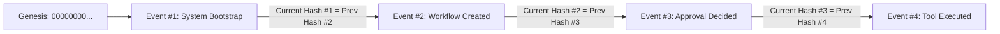

# Tamper-Evident Audit Logging — EnterpriseFlow AI

## 1. Cryptographic Design

The audit logging mechanism implements an append-only, cryptographic hash-chained ledger:

$$\text{Hash}_n = \text{SHA-256}\left(\text{Seq}_n \parallel \text{Hash}_{n-1} \parallel \text{ActorID} \parallel \text{EventType} \parallel \text{Action} \parallel \text{Payload} \parallel \text{Timestamp}\right)$$

- **Genesis Hash**: For Sequence #1, `previous_hash` is initialized to 64 zero characters:
  `0000000000000000000000000000000000000000000000000000000000000000`
- **Tamper Evidence**: Modifying any field (actor, description, payload, result) breaks the chain for all subsequent entries.

## 2. Integrity Verification

The `/api/v1/audit/verify` endpoint verifies:
1. Every event's `previous_hash` matches the preceding event's `current_hash`.
2. Every event's `current_hash` exactly equals the freshly recomputed SHA-256 digest over its stored attributes.
3. If any discrepancy is discovered, the verification endpoint returns `valid: false` and identifies the tampered sequence numbers.

The UI includes a **"Simulate Tamper Test"** button to allow live verification of this tamper-detection capability.

