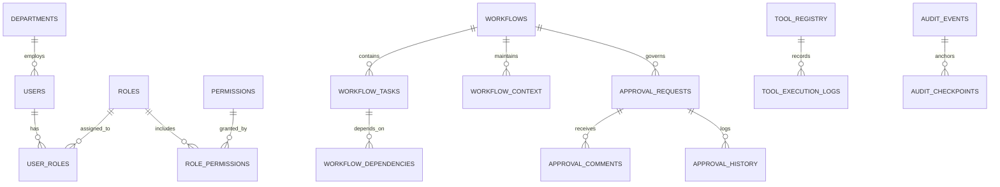

# Relational Database Schema — EnterpriseFlow AI

The database architecture is implemented with SQLAlchemy and normalized into 15+ relational tables.

## Primary Entities

1. `users`: UUID pk, email, full_name, avatar_url, department_id, is_active.
2. `roles`: UUID pk, name (e.g. Finance Director, IT Security Admin), description.
3. `departments`: UUID pk, name, code, head_user_id.
4. `workflows`: UUID pk, title, domain, status, priority, risk_level, raw_input, extracted_entities, planner_plan, started_at, completed_at.
5. `workflow_tasks`: UUID pk, workflow_id, task_key, agent_name, title, description, execution_order, status, input_payload, output_payload, error_details, required_approval_id.
6. `workflow_context`: UUID pk, workflow_id, key, value, written_by_agent, created_at.
7. `approval_requests`: UUID pk, workflow_id, task_id, title, domain, risk_level, status, priority, requested_by_agent, requesting_employee, department, financial_amount, proposed_payload, approved_payload, required_role, due_date, decided_by_name, decided_at, decision_reason.
8. `approval_comments`: UUID pk, approval_id, author_name, author_role, comment_text, created_at.
9. `approval_history`: UUID pk, approval_id, action, actor_name, notes, created_at.
10. `tool_registry`: UUID pk, key, name, category, risk_level, requires_approval, is_simulated, mock_service_name, idempotent.
11. `tool_execution_logs`: UUID pk, tool_key, agent_id, workflow_id, task_id, idempotency_key, request_payload, response_payload, status, execution_time_ms.
12. `audit_events`: UUID pk, sequence_number, workflow_id, actor_type, actor_name, event_type, action_description, payload_reference, execution_result, previous_hash, current_hash, timestamp.
13. `recovery_attempts`: UUID pk, workflow_id, task_id, error_type, error_message, attempt_number, max_attempts, strategy, status.

