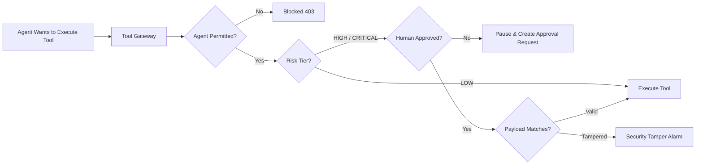

# Security & Governance Model — EnterpriseFlow AI

## 1. Zero Trust Agentic Governance

Traditional LLM assistants grant conversational agents direct or unverified API access. EnterpriseFlow AI enforces a **Zero Trust Agentic Architecture**:

## 2. Core Security Controls

1. **Role-Based Access Control (RBAC)**: Only designated roles (e.g. `Finance Director`, `IT Security Admin`) can authorize domain-specific actions.
2. **No Agent Self-Approval**: Agents attempting self-authorization are blocked by code logic.
3. **Cryptographic Payload Binding**: When an approver reviews a proposed payment or system grant, the payload is captured. If an agent attempts to execute with modified amounts or targets, the Tool Gateway aborts with `SECURITY_TAMPER_DETECTED`.
4. **Tamper-Evident SHA-256 Audit Chaining**: Every action is cryptographically chained. Any retroactive database tampering is flagged immediately by the verification engine.
5. **Simulated Integration Isolation**: All mock adapters explicitly return `is_simulated: true` and are isolated from actual payment rails or live production clouds.

