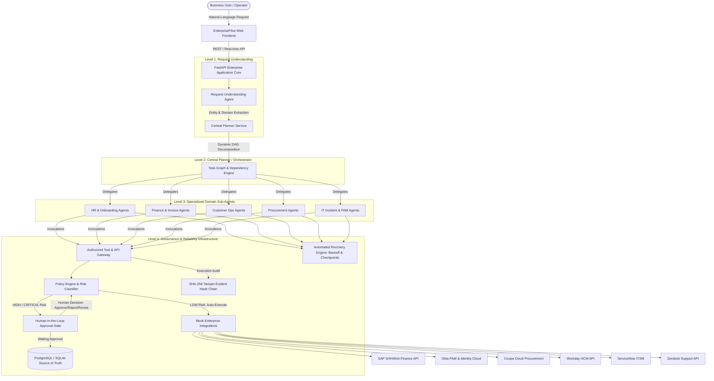

# System Architecture — EnterpriseFlow AI

## 1. High-Level Architecture Overview

EnterpriseFlow AI is an autonomous, hierarchical multi-agent enterprise operations platform with backend-enforced Human-in-the-Loop governance.

## 2. Architectural Layers

### Level 1: Request Understanding
- Interprets freeform business text.
- Extracts entities (currency figures, vendor names, dates, systems, candidate details).
- Routes to corresponding workflow domain.
- Detects constraints and incompleteness.

### Level 2: Central Planner & Dynamic Orchestrator
- Understands overall business objectives.
- Decomposes requests into executable task DAGs.
- Computes dependencies and execution orders.
- Evaluates execution results and supports re-planning upon human feedback.

### Level 3: Specialized Sub-Agents
- 17 specialized agents with distinct system instructions, schemas, and tool allowances.
- Communicates via structured shared workflow context.
- Adheres to least-privilege permission boundaries.

### Level 4: Governance, Authorization & Audit
- **Policy Engine**: Decoupled risk classification (LOW, MEDIUM, HIGH, CRITICAL).
- **Authorized Tool Gateway**: Inspects every call; strictly prevents unapproved high-risk operations.
- **Human-in-the-Loop Approval Center**: Empowers human operators to approve, reject (with reason), or request revisions.
- **Recovery Engine**: Idempotency checks, exponential backoff, checkpointing, and escalation.
- **Tamper-Evident Audit Service**: Append-only SHA-256 hash chaining.

